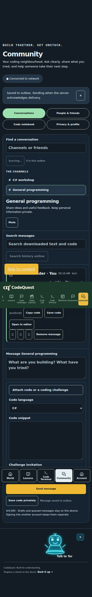
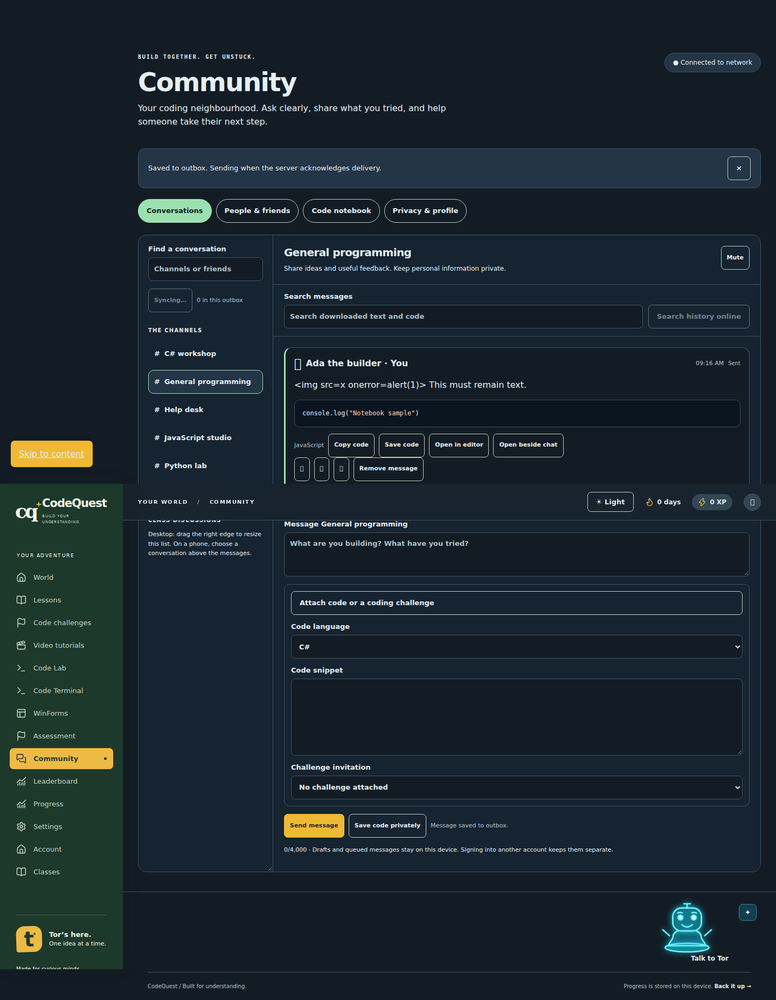
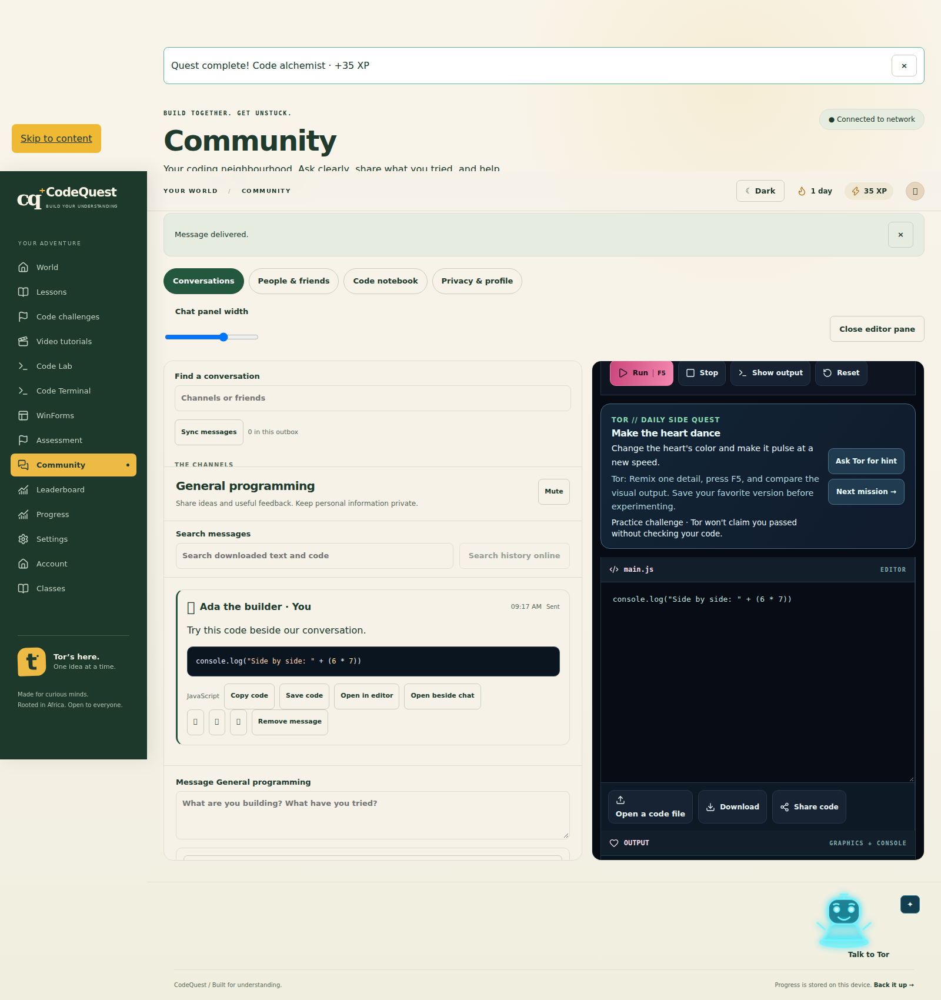
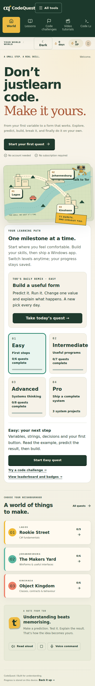
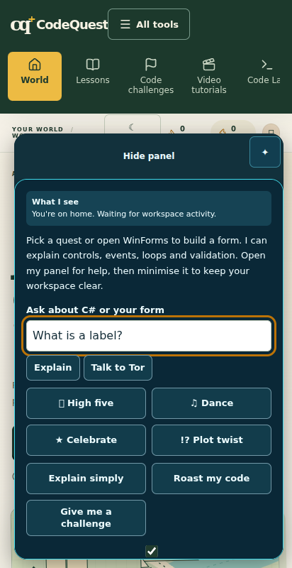

# Community implementation verification

Date: 2026-10-14. Development branch: `feature/codequest-community`.

The shared brief asks for an isolated implementation and pull request before production release. No Community migration has been applied to the hosted production database and this branch has not been merged to `main`.

## Results

| Check                                | Actual result                                                                                                            |
| ------------------------------------ | ------------------------------------------------------------------------------------------------------------------------ |
| Baseline before changes              | 118 unit/database tests, type check and production build passed                                                          |
| Final unit/database suite            | 130 passed; includes real Postgres RLS/trigger tests through PGlite                                                      |
| Existing browser regression          | Earlier module run: 90 passed, 1 failed, 1 skipped out of 92                                                             |
| Tor caption regression fix           | Fixed the failure; both tests in `runtime-coach.spec.mjs` passed on rerun                                                |
| Previously skipped 3D Tor test       | Passed again in the final nine-check software WebGL run                                                                  |
| Existing account/cloud fixture suite | All 12 passed after account and Classroom updates                                                                        |
| Community browser suite              | All 11 passed                                                                                                            |
| Snippet download follow-up           | 1440px case passed again with an explicit `.js` filename assertion                                                       |
| TypeScript / production build        | Passed; final production build restores the real client configuration                                                    |
| Formatting                           | Existing Prettier checks passed for the new module/tests/config/docs; no separate ESLint setup exists in this repository |
| Patch hygiene                        | `git diff --check` passed                                                                                                |

The later complete Classroom regression run exercised 97 checks: 95 passed, one failed on Classroom horizontal overflow and one opt-in 3D check was skipped. The overflow was fixed and the all-route phone/accessibility check passed on rerun. Across the completed regression runs and the focused reruns, all 92 original browser checks were exercised successfully. The normal non-WebGL run still skips the opt-in 3D case by design; CI now also runs that case explicitly with software WebGL. Do not misread the initial failing run as a clean first pass: it found and led to the Tor caption fix.

## What the Community browser checks verified

1. Two isolated browser accounts exchanged persisted public messages and code. Private messaging required an accepted friend request; a third authenticated database identity could not read the DM. Blocking revoked access.
2. Private saved code opened in the existing terminal without running automatically.
3. A draft survived refresh. Offline queueing kept the message unsent until reconnect, then delivered it exactly once. A second account did not restore the first account's draft.
4. At 320, 360, 412 and 1440 CSS pixels: readable dark mode, no horizontal document overflow, safe literal rendering of HTML-like message text, saved notebook access and safe editor transfer.
5. A class owner created and locked a discussion. Enrolled learners could react and report; the owner could resolve the report. An outsider could not access the class.
6. Unread counts, mute preferences and history search stayed scoped to the conversation.
7. At 1600px, code opened beside the chat, the width control adjusted the layout without overlapping panes, and output appeared only after Run.
8. A version-1 IndexedDB database upgraded while retaining its draft and snippet. Listing the guest notebook did not display another account's stored item.
9. A code download retained the selected language extension so it can be imported into the existing terminal.

The SQL tests additionally cover immutable sender/timestamp fields, idempotent UUID replay, attempts to reuse a UUID with altered content, private-room consent, third-user isolation, either-sided blocking, revoked friendship, class enrollment and locks, unauthorized reports/reactions, rate limits, private read preferences and moderator boundaries. A site moderator can inspect the **reported** private message without reading the rest of the DM.

## Fixes made during verification

- Corrected new-room SELECT/INSERT permissions for consent-based private conversations.
- Fixed test protocol handling for the installed Realtime client's v2 wire format; the application still uses the real Supabase SDK.
- Prevented the phone bottom bar from reappearing mid-gesture while moving focus between composer controls. The attachment section now uses an explicit controlled button.
- Restored the last conversation and kept drafts partitioned by account/room.
- Added an IndexedDB owner/type index so reading the outbox or notebook does not pull every conversation cache into memory; the upgrade preserves existing records.
- Added friendly service-setup, network and permission errors rather than exposing raw database table names in the UI.
- Updated Tor's workspace explanation to include a selected label's actual visible caption. The existing regression test caught this pre-existing mismatch.
- Corrected snippet download extensions.

## Test environment and limits

The browser fixtures use the **actual application UI, browser IndexedDB and a real local Postgres engine (PGlite)**. Authentication responses and the Supabase HTTP/Realtime transport are test adapters. The adapters execute queries with the authenticated database role and the actor's claim; they do not bypass RLS for application requests. They check visibility before emitting simulated Realtime changes.

These are not two real hosted Supabase accounts. Hosted Supabase Auth/Realtime, staging migration/advisors and a physical Android software keyboard remain release checks. Emulated screen widths and software WebGL do not certify every phone or GPU. No claim of physical Windows native GUI testing is made in this session.

The normal Playwright browser download returned invalid archives in this environment. Browser validation used Chromium 153 from the published `@sparticuz/chromium@153.0.0` package, extracted in temporary tooling storage. That package is **not** a CodeQuest dependency and was not added to the repository. Software WebGL used that package's SwiftShader libraries. The existing pinned Playwright dependency ran the tests.

## Screenshots

These screenshots show local fixture accounts and test messages, not real production users. WebP conversion is lossless. Some emoji fonts are unavailable in the headless test runtime; the illustrated Tor fallback remains usable.

### Android-sized conversation, 412px, dark mode

### Desktop conversation, 1440px, dark mode

### Chat and running code beside each other

## Release status

Ready for source review as a **draft PR**. Do not describe the Community feature as deployed to production. Follow the staging checklist and rollback plan in [COMMUNITY.md](COMMUNITY.md), then review the CI results and hosted two-account checks before recommending merge/release.

## Classroom and Android follow-up

The subsequent user feedback moved Community and private messaging into Classroom behind sign-in. Existing `#community` links enter the same authenticated Classroom hub. Guest learning and code tools remain available. Class owners create/join classes, assign quests and view only progress that learners explicitly share; the product does not supply a lecturer or live lessons.

The Android screenshot led to a bounded phone tutor panel, a compact closed avatar, a visible All tools menu, and fixes for overlapping Tor buttons and an absolutely positioned hidden 3D loading container that caused horizontal overflow on Classroom. The expanded tutor header retains readable light text. Tests cover 360px and 412px viewports, saved desktop positions, panel minimisation and the phone menu.

WinForms now opens/focuses the default C# Click handler for labels as well as buttons, including touch double-taps. Opening it twice reuses the method. Inert design surfaces prevent nested disabled controls intercepting pointer gestures. Design-time buttons no longer fade selected colours; colour changes are handled during input, persisted, displayed at runtime and exported with visual-style background overrides disabled. LinkLabel respects an explicitly selected black foreground.

Read-only production investigation confirmed the live bundle uses the configured Supabase project, signups are enabled and email confirmation is automatic. Aggregate account logs contained invalid-credential and already-registered responses. This supports the repeat-signup/password confusion, but does not prove the cause for a particular user's account. No passwords, email addresses or tokens were retrieved, and no existing account settings or passwords were changed. The client now normalises email, permits older short passwords at sign-in, provides explicit password visibility, and explains that repeat signup does not change an existing password. Duplicate-registration errors are handled with either structured codes or legacy message responses. Password recovery delivery still requires a real hosted email round trip.

The final software WebGL run passed all nine selected checks: all-route phone layout/accessibility, button and label handler opening/focus/reuse and real C# click execution, colour persistence/undo/redo/runtime, 360px and 412px Tor layout, touch double-tap, the phone tool menu, and authored 3D Tor rendering/movement/reduced motion.

The latest account/cloud suite passed all 12 tests. The updated Community suite passed all 11 tests, including the authenticated Classroom gate and preserving version-1 IndexedDB data under its original account. These runs used the test transports described above.

### Android World and tutor panel after the follow-up

## Continuous practice and backup follow-up — 14 October 2026

Recovered the published PR head in an isolated checkout after the session reopened an older local workspace. The interrupted run's missing logs are not used as evidence. Checkpoint `73197ef` saves the renewed work remotely.

Changes: original Units 1–7 revision exercises, recurring five-answer goals, real C# coding remixes, bounded saved practice state, opt-in automatic cloud backup with revision conflicts and manual-save coordination, current visual feedback from Tor during rapid edits, chat synchronization locking/jitter/backoff, redundant read-receipt suppression, server-side profile search beyond the first 200 cached entries, and explicit self-reported ranking language. The ranking database test now includes 405 public participants plus a private row.

Fresh verification:

- Unit/database suite: 132 passed. TypeScript and production build passed.
- Full browser regression: 100 passed; one optional software-WebGL test skipped by the default configuration. Includes compilers, learning progression, seven original coding challenges, new revision/coding-remix flows, Android layout, accessibility, native ZIP export, offline startup/runtime caching and Tor caption reactions.
- Account/class browser fixtures: 14 passed, including account isolation, cloud restore, duplicate signup, password visibility/normalization, automatic backups, conflict pausing and manual saves after automatic revision changes. The fixture now enforces expected snapshot revisions.

See LAUNCH-AND-DISTRIBUTION.md for capacity limits, packaging steps, revenue models and release requirements. A 405-row database test is not a 400-concurrent-user load test. No full-world-readiness percentage is claimed. Vercel reported successful deployment status through GitHub for the checkpoint, but its deployment-details connector returned 403 for the project team, and no authenticated CLI fallback was available. Hosted preview behaviour could not be verified through that connection. Production Community, real reset-email delivery and physical Android testing remain outside the fixture evidence.

## Final verification — 15 October 2026

- Re-ran `npm run check`: 132 unit/database tests passed, TypeScript passed, production build passed.
- Re-ran the final practice browser checks: 3 passed, including all seven original challenges, renewable practice on a phone, and coding-remix/source restoration after reload. Inspected the 390px screenshot; no horizontal overflow or oversized tutor overlay.
- Re-ran account/cloud fixtures: 14 passed. Re-ran Community fixtures: 12 passed, including finding member 405 through server search and phone layouts at 320px, 360px and 412px.
- GitHub Actions run 38623420786 for checkpoint `73197ef` completed successfully: full browser regression, explicit software-WebGL Tor check, cloud and Community suites, production build, and Windows `dotnet build` of the exported WinForms solution. The final follow-up edits above have fresh local coverage; this checkpoint CI result is not a claim about a later commit.
- The PR remains a draft. No production merge or hosted Community migration was performed. Authentication fixture success does not establish that the reported user's real credentials or password-reset email delivery now work.

## Assessment repair and report follow-up — 15 October 2026

See [DEBUG-REPAIR-LAB.md](DEBUG-REPAIR-LAB.md) for the seven repair missions, buffered C# console, recorded trace/replay controls and explicit live-debugger limitations. The test report's exact cold first-lesson starter now gets wrong-answer feedback. Startup/diagnostic preparation is separated from the execution timeout, and timeouts no longer diagnose an infinite loop without evidence. Tor has explicit polite, atomic voice status and accessible arrow-key movement instructions.

Fresh evidence: 135 unit/database tests, TypeScript, production build, nine focused browser checks covering seven missions with 33 cases, C# lesson/runtime regressions, draft restoration, keyboard movement, unavailable speech, the report reproduction and 360px dark trace accessibility. Earlier in this follow-up, all seven existing code challenges passed. Real screen-reader software and physical Android devices were not exercised. These source changes remain on the draft branch, separate from production.

## Student and lecturer scenarios — 15 October 2026

Added the supplied equipment-booking practice as a native recovery brief/source download and browser logic mission, plus two original project variations. Repair practice now includes ten missions with 81 checks. Classroom can assign them and share completed repair IDs explicitly; its delayed-response regression protects class switching. Tor has a larger study desk, local conversation/practice, student/lecturer coaching and official reference links. No live model or autonomous web browsing is configured.

Verification: 138 unit/database tests and TypeScript passed; the saved full browser report shows 108 passed and one optional 3D skip. A separate software-WebGL test passed, as did an additional offline Tor/project-download flow. The account suite's 13 passing cases and two corrected lecturer-test rechecks cover all 15 account/Classroom cases. Community passed all 12 tests. The lecturer rechecks corrected test locators, not application semantics. See STUDENT-LECTURER-VERIFICATION.md for evidence boundaries, missing bookings.txt, native-project requirements and the distinction between fixture and hosted behaviour. No production merge or hosted Community migration occurred.

## Renewable projects and editor completion — 15 October 2026

Added a daily repair entry point, on-demand deterministic project variations, active/previous generated-draft recovery and export. The rich C# editor now offers declared names/types, reviewed common member hints, project-file/control context and pointer/Tab/Enter selection. It retains Tab-twice snippets. Browser checks caught and fixed rapid acceptance and menu viewport issues. This is offline assistance, not full Visual Studio semantic IntelliSense.

All 142 unit/database tests, TypeScript and final production build passed. Fourteen focused browser cases passed, plus repeat suggestion runs, covering generated grading, South African midnight, state recovery, all seven original coding challenges, editor execution, Visual Studio shortcuts and Android/WinForms regressions. Previous published commit 5b4a5b4 completed GitHub CI run 38731827642 successfully, including Community/account suites, 3D and Windows export compilation. No production merge or Community migration was performed. See DAILY-PROJECTS-AND-COMPLETION.md.
