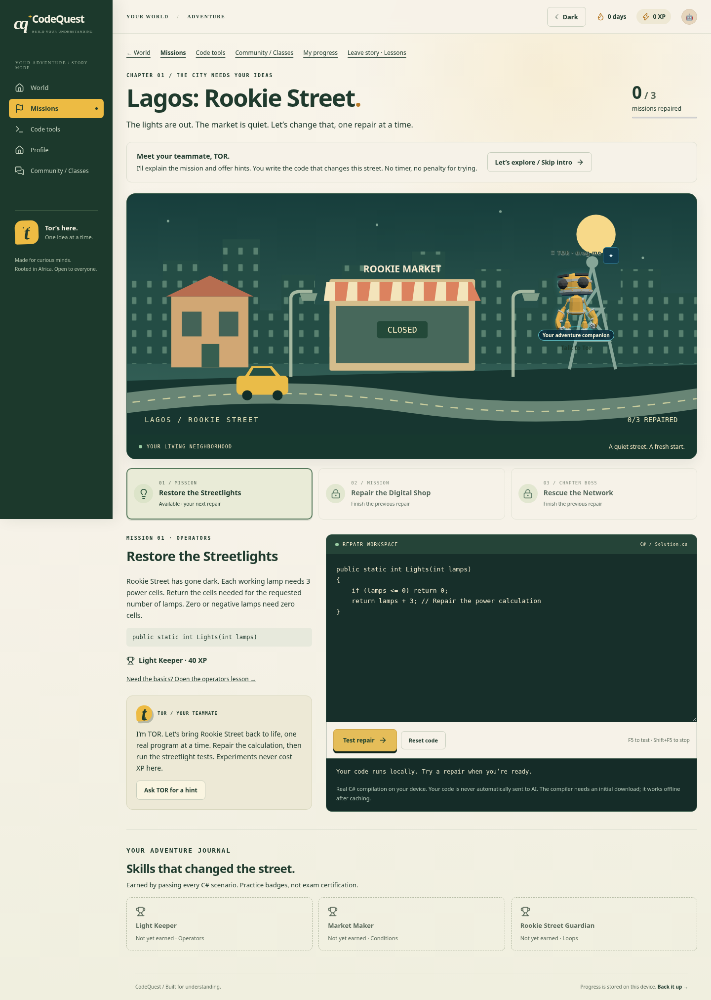
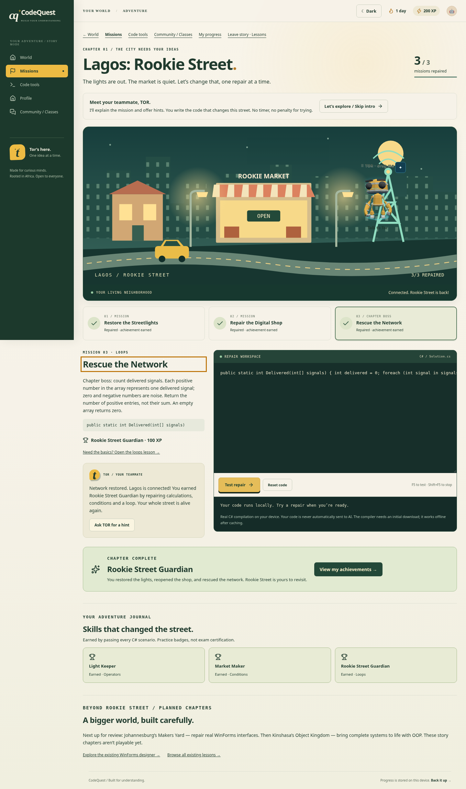

# Lagos adventure — first playable chapter

Issue [#42](https://github.com/jakeharvey162-source/code-quest/issues/42) adds optional Story Mode to the existing CodeQuest app. Start Adventure on World opens **Lagos: Rookie Street**. Normal lessons, Code Lab, Code Terminal, WinForms, accounts, classes, community, and TOR remain available through their existing routes.

## What the player does

| Repair | C# skill | Visible result | Earned reward |
| --- | --- | --- | --- |
| Restore the Streetlights | Operators and boundary inputs | Lamps and house windows glow | Light Keeper · 40 XP |
| Repair the Digital Shop | Variables and AND conditions | Rookie Market opens | Market Maker · 60 XP |
| Rescue the Network | Loop, filtering, and counting | Network signal returns; chapter completes | Rookie Street Guardian · 100 XP |

A repair requires every scenario to pass through the existing local WasmSharp/Roslyn compiler. Opening a page, asking for a hint, or editing code does not award completion. Achievements and XP are earned once; completed repairs can be retried. Story experiments and compiler errors cost no XP. Existing challenge-penalty behavior outside Story Mode is unchanged.

TOR provides authored mission introductions, optional hints, compiler-error guidance, and celebrations through the existing companion. These remain available without an AI provider. Mission code is not automatically added to online AI requests. The compiler requires its initial asset download before offline execution can work.

Mission achievements use the existing `Progress.steps`; drafts and introductory-dialogue preference use `Progress.drafts`. This retains version-1 compatibility, guest persistence, account isolation, backup/restore, and existing cloud-snapshot handling. The journal derives the repaired street and badges from a sequential prefix of known missions. These are local learning achievements, not verified exam marks or a tamper-proof certification system.

## Visual review

The before images show the original World entry. The after images show the new chapter, including the repaired street and journal. Screenshots are review artifacts; automated and manual validation results are reported separately.

| Viewport | Before | After |
| --- | --- | --- |
| Desktop · 1440 px | [Original World](before-1440.png) | [World entry](world-after-1440.png) · [First mission](lagos-desktop-start.png) · [Completed chapter](lagos-desktop-complete.png) |
| Mobile · 320 px | [Original World](before-320.png) | [Completed chapter](lagos-320-complete.png) |
| Mobile · 360 px | [Original World](before-360.png) | [Completed chapter](lagos-360-complete.png) |
| Mobile · 412 px | [Original World](before-412.png) | [Completed chapter](lagos-412-complete.png) |

## Manual review checklist

These are review steps, not additional test-pass claims.

- Start from World as a new guest. Enter Story Mode, skip the short TOR introduction, and reach the first editor without signing in.
- Submit a syntax error and a compiling but incorrect repair. Confirm useful feedback, unchanged XP, preserved code, and locked later missions. Ask for both free hints.
- Solve all scenarios for each repair. Inspect the matching street change, TOR response, earned badge, and next-mission action. Retest a completed repair and confirm XP stays unchanged.
- Refresh mid-mission, leave for a normal lesson, and return using Continue mission. Verify the draft, introduction preference, completed repairs, and journal persist.
- Export and restore a backup containing adventure progress. For a test account, exercise cloud save/restore and account switching with existing conflict protections; verify another account does not inherit a private draft.
- Navigate at 320, 360, and 412 px, then at desktop width. Check code editing, wrapped feedback, full-width success content, readable navigation, and TOR minimization without obscured actions.
- Use only the keyboard: skip link, mission selection, editor exit, hints, F5, Shift+F5, and next repair. Check visible focus and screen-reader announcements for compiler feedback and completion.
- Enable reduced motion in the app and OS. Complete a repair and confirm the street still changes without celebration motion. Check light/dark themes and contrast.
- After the compiler is cached, disconnect the network and retry. Check authored TOR help remains useful. Inspect requests to confirm editing, running, and receiving a local hint do not upload code to AI.
- Open existing lesson, terminal, WinForms, account, classroom, community, and progress routes directly. Verify the existing shared-snippet flow still requires an explicit Run action.

The existing automated unit, browser, cloud, and community suites remain the regression path. See [native export validation](native-validation.md) for the actual .NET cross-compilation evidence and its Windows-runtime limitation. Consult the pull request's final validation report for current suite outcomes; this document does not imply live hosted-service or Windows CI success.

## Next chapters — plan for review

Ship and review Lagos first. Use learner feedback on mission clarity, hints, mobile editing, and persistence before extending the story.

1. **Johannesburg: Makers Yard.** Repair a registration form, wire a genuine C# event, and validate a useful application. Reuse the current WinForms designer, event runtime, system grader, and native export. Completion must depend on functional checks, with design guidance kept distinct from runtime proof.
2. **Kinshasa: Object Kingdom.** Refactor a small working program into classes, protect state through methods, and combine objects into an original system. Reuse multi-file C# editing and existing OOP lessons. The chapter milestone is a tested capstone rather than a combat or chance reward.

Neither future story chapter is implemented in this slice. Their existing lessons and tools remain usable now. Keep story navigation optional, preserve older saves, reward demonstrated skills once, and retain nonpunitive experimentation in future missions.
